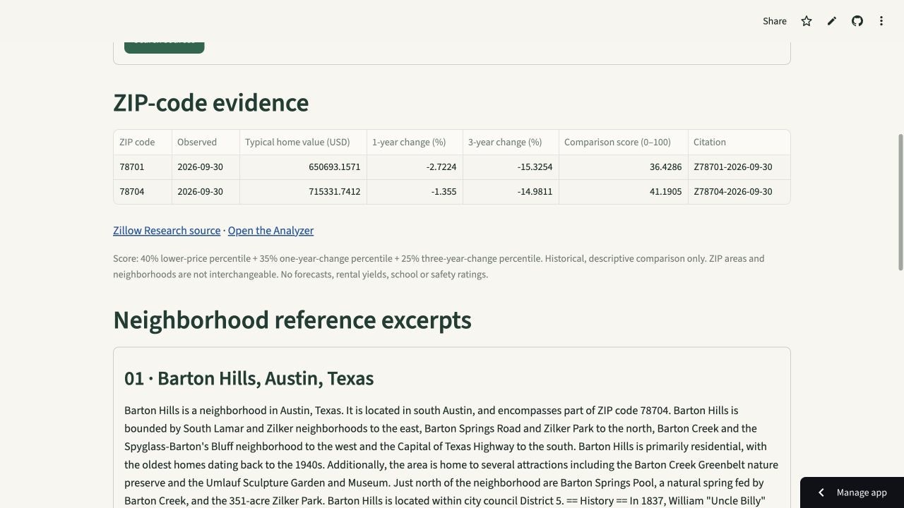

# ZipRAG: Austin, with sources

A Python reference-search app and read-only MCP server combining sourced Austin articles with the Analyzer’s dated ZIP-code scores.

**[Open the free live demo →](https://spattoor-ziprag.streamlit.app/)**



## Working free features

- Search 18 attributed Wikipedia articles, split into 109 overlapping passages, with SQLite FTS5 and local TF-IDF vectors.
- Retrieve source excerpts with article links, revision IDs, download dates and citation IDs.
- Query exact ZIP codes and observation dates against the Analyzer’s SQLite scores; missing records stay missing.
- Read the current verified AWS snapshot through CloudFront, with checksum and database-integrity validation. Offline fallback is explicitly labeled.
- Expose the same search and score-lookup functions through a real stdio MCP server.

No model API key or credits are needed for these features. Free mode returns excerpts and stored values, not a generated answer. Local TF-IDF vectors are lexical representations, not neural embeddings.

## Run from a fresh clone

Use Python 3.11 or newer:

```bash
git clone https://github.com/spattoor/ZipRAG.git
cd ZipRAG
python3 -m venv .venv
source .venv/bin/activate
python -m pip install -r requirements.txt
python -m streamlit run app.py
```

The document index builds locally from the included, checksum-verified corpus. A dated Analyzer snapshot is included, so the free tools still work without a network connection. Windows activation: `.venv\Scripts\activate`.

## Verify and evaluate

```bash
python -m unittest discover -s tests -v
python -m ziprag evaluate
python -m ziprag search "Which neighborhood contains Ramsey Park?"
python -m ziprag scores 78701,78704
```

Sixteen tests passed, including a real MCP subprocess handshake, both tool calls, a provenance-resource read, UI search, source integrity, ZIP/date validation, unknown citations, corrupted downloads and optional-provider stubs.

The ten-question development set retrieved its expected article in the top three for **10/10 questions**. This is a small authored source-retrieval check, not a held-out benchmark, answer-correctness measurement, or Claude result. See [questions](evaluation/questions.json) and [reproducible report](evaluation/results.json).

## Connect an MCP client

```bash
python mcp_server.py
```

Claude Desktop configuration (replace both paths):

```json
{
  "mcpServers": {
    "ziprag": {
      "command": "/absolute/path/ZipRAG/.venv/bin/python",
      "args": ["/absolute/path/ZipRAG/mcp_server.py"]
    }
  }
}
```

Tools: `search_documents(query, limit=3)` and `lookup_zip_scores(zip_codes, month=None)`. Resource: `ziprag://provenance`. The client chooses tool calls; local tools do not consume model API credits. The client may have its own subscription or usage limits. This is a local stdio server, not a hosted remote MCP endpoint. MCP SDK 1.30.0 is pinned on its supported v1 maintenance line.

To refresh the bundled housing database from the Analyzer’s current public snapshot:

```bash
python -m ziprag sync-scores
```

## Optional provider integrations: implemented, not live-verified

Claude tool-use orchestration is implemented in `ziprag/claude.py`, with two bounded tools, a four-round limit, validated arguments and retrieved-citation checks. Provider behavior is tested with stubs only. No live Claude API call was made, and the public free UI keeps this mode disabled. Enable only with your own provider credits and secure server settings: `ZIPRAG_ALLOW_CLAUDE=1`, `ANTHROPIC_API_KEY`, and `CLAUDE_MODEL`. Citation-ID validation does not prove every generated statement is semantically supported.

Optional OpenAI embeddings are implemented separately from the free baseline:

```bash
# Explicit opt-in; requires OPENAI_API_KEY and incurs provider usage.
python -m ziprag openai-embeddings
```

The embedding adapter has stub-based tests; live embedding calls are not verified. Keys belong in an ignored `.env` or the host’s secure secrets, never in GitHub or chat.

## Data and limitations

Wikipedia source text and derived chunks: [CC BY-SA 4.0, with attribution](docs/ATTRIBUTION.md). Housing data: [Zillow Research](https://www.zillow.com/research/data/) via the [Analyzer](https://github.com/spattoor/Austin-Real-Estate-Analyzer/tree/portfolio-cloud-upgrade).

The housing snapshot contains 546 rows across 42 ZIP areas with observations through September 30, 2026. Neighborhood articles do not establish authoritative ZIP boundaries. Scores describe historical home values and changes; they do not establish safety, school quality, rental yield, future prices, or investment returns.
